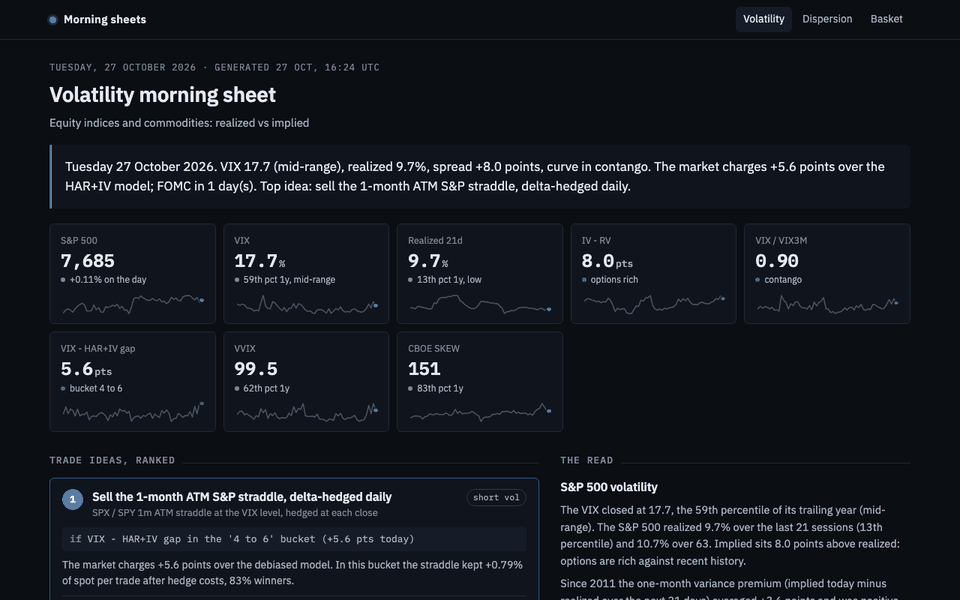

# Volatility Dashboard: equity indices and commodities

**Live morning sheet: [https://morning-sheet-olive.vercel.app/vol](https://morning-sheet-olive.vercel.app/vol)**, regenerated every weekday after the US close.



Interactive Streamlit dashboard that compares **realized and implied volatility** across
equity indices (S&P 500, Nasdaq 100, Russell 2000, Euro Stoxx 50) and commodities
(WTI crude, gold, silver, natural gas), built on free data so anyone can rerun it, with
three research questions answered on top: can the VIX be rebuilt from a retail option chain,
does implied vol forecast realized vol better than history, and how does crude vol behave
along the futures curve.


## Three results worth defending

**1. The VIX, rebuilt from SPY options, lands within 0.2 point of the official print.**
The VIX is the square root of a 30-day variance swap rate, not an average of implied vols.
`vix.py` applies the CBOE white-paper recipe (OTM strip weighted by 1/K², two expiries
bracketing 30 days, interpolation in total variance) to SPY quotes. On 2026-10-27 the strip
gave 17.65 against a 17.79 close. A side product: puts carry about 73% of the variance
although they are half the strikes. That is the skew, visible inside the index.

**2. Implied vol is the best predictor of future vol, and it is biased by 3.6 points.**
`forecast.py` runs an expanding-window, monthly-refit, out-of-sample race at a 21-day
horizon: naive RV22, HAR-RV (Corsi 2009), GARCH(1,1), the CBOE index, and HAR + implied.
On the S&P 500 since 2017 the implied index has the best QLIKE and Mincer-Zarnowitz R²,
overshoots realized by 3.6 points on average (the variance risk premium), and HAR + implied,
which corrects that bias, has the lowest RMSE. The same race runs on Nasdaq, crude and gold.

**3. Crude vol decays along the curve, and the curve says when to sell it.**
`crude.py` pools realized vol across every listed WTI contract by time to maturity: today
the front month realizes about 32% while the 12-month contract realizes 11%, the Samuelson
effect. The Dec/Dec calendar spread, the trader's gauge of backwardation, does not predict
OVX in this sample (2020's super-contango at 100+ vol dominates), but it does sort the
premium: selling crude vol earned +4.3 points on average in backwardation versus -0.6 in
contango.

**4. The premium is earned by hedging, and the hedging P&L is the gamma-theta identity.**
`hedging.py` sells a one-month ATM straddle at the VIX, delta-hedges it every close on the
real S&P path, and holds to expiry, with hedge costs and an option bid-ask. Since 2005: 261
trades, 79% winners, about 0.6% of spot per month after costs, worst month September 2008.
The identity ½ Σ Γ S² (σ²impl dt − r²) explains 98% of the trade-by-trade P&L, and a scatter
against a variance swap of the same vega shows the straddle's path dependence.

**5. Event vol is fairly priced; generic vol is not.**
`events.py` extracts forward vols from the VIX term structure and the variance the 9-day tenor
carries for a FOMC inside its window. Over 94 meetings since 2015 the market priced a 0.69%
move and the S&P realized 0.80%. The carry lives in the days with no scheduled news. Live, the
same arithmetic on the two SPY expiries around the next FOMC gives the implied move for that day.

**6. The implied-minus-model gap tells you how much you are paid, not when to sell.**
`signal.py` buckets the gap between the VIX and the HAR+IV forecast: the forward premium rises
from 3 to 6 points as the gap widens, but selling only on wide gaps does not beat selling every
month on a risk-adjusted basis. Skipping months loses more carry than it avoids losses.


## What the dashboard shows

| Tab | Content |
|---|---|
| **Overview** | Cross-asset table: spot, realized vol 21d / 63d, CBOE 30d implied, IV - RV, 1y percentiles |
| **Realized vs implied** | Four realized estimators against the CBOE index, and the volatility risk premium (implied today vs realized over the next 21 days) |
| **Vol cone** | Distribution of realized vol by horizon (10d to 252d) over five years, current realized and implied overlaid |
| **Term structure** | VIX9D / VIX / VIX3M / VIX6M / VIX1Y curve, VIX/VIX3M ratio history, VVIX and SKEW |
| **Skew** | Live smile from the option chain of a liquid ETF proxy: ATM, 25-delta risk reversal and butterfly, by moneyness and by delta, plus the skew history built by the daily snapshot |
| **Commodity curve** | Futures curve contract by contract, contango / backwardation, annualized roll yield |
| **VIX replication** | CBOE methodology on SPY, strip contributions by strike, gap to the official print |
| **Forecasting** | HAR-RV vs GARCH vs implied vs HAR+IV, loss table (RMSE, QLIKE, Mincer-Zarnowitz) and forecast plots |
| **Crude research** | Samuelson effect today and pooled since 2018, Dec/Dec spread history, OVX and VRP by curve regime |
| **Harvesting vol** | Delta-hedged short straddle backtest with costs, gamma-theta identity, forward vols and FOMC event premium (history and live), implied-minus-model gap as a signal |

## Decisions, and why

- **Implied vol is rebuilt, not read.** Yahoo's `impliedVolatility` field ignores the forward,
  so a put and a call at the same strike disagreed by five vol points. `options.py` takes the
  mid, backs out the forward from put-call parity on near-the-money pairs, inverts Black-76
  on that forward, and quotes ATM, 25d risk reversal and 25d butterfly off forward deltas.
  Result: a smile that is continuous across the put/call boundary.
- **Black-76 rather than Black-Scholes** because everything is expressed on the forward:
  dividends on SPY and carry on commodity ETFs are absorbed by the implied forward instead of
  being guessed.
- **A flat 4% rate.** At one to three months the discount factor is 0.99 and a 1% error in
  the rate moves a 20% IV by less than 0.02 point. Not worth a curve.
- **Yang-Zhang as the headline estimator** because it is robust to overnight gaps and drift,
  but all four are shown because they disagree, and the disagreement is information
  (Parkinson below close-to-close means the moves happen overnight).
- **HAR on log vol with Parkinson as the daily term.** A single day's squared return is too
  noisy; the range carries about five times more information. Log space keeps forecasts
  positive and tames 2020.
- **QLIKE next to RMSE.** With a noisy realized proxy, RMSE rewards forecasts that shrink
  toward the mean; QLIKE is the loss that stays consistent (Patton 2011).
- **Zero-volume days are dropped from the Samuelson panel.** A stale settlement on a 2029
  contract in 2019 looks like zero vol and would fake the effect.
- **Dec/Dec spread as the curve gauge** because both legs have years of history on free data,
  while the true front-month spread cannot be rebuilt once contracts expire.

- **Hedging at the implied vol, not the realized.** A desk hedges at the vol it sold; hedging at
  the realized vol would smooth the P&L but is not implementable.
- **Costs in the straddle backtest**: 1 bp per rebalance on the index and 0.5 vol point of
  bid-ask on the option, both adjustable in the app. Gross numbers would be marketing.
- **FOMC only, hard-coded.** CPI and payrolls would need 150 more dates; the FOMC is where the
  event premium is cleanest to read in the VIX9D.

## Tests

```bash
.venv/bin/python -m pytest -q tests
```

Twenty-two tests check the finance, not the plumbing. Among them: the four realized estimators recover the
sigma of a simulated GBM and Parkinson's efficiency gain is where Parkinson (1980) says it is;
Black-76 round-trips price to IV; the implied forward is recovered from a chain priced off a
forward away from spot; the risk reversal has the right sign on put-skewed and call-skewed
synthetic chains; and the CBOE strip returns the input variance on a flat-vol chain, with and
without rates, and puts more weight on puts when the chain is skewed.

## Daily skew snapshot

Nobody gives away a history of the 25-delta risk reversal. `scripts/snapshot_skew.py`
captures it for every asset at 30 and 90 days and appends to `data/skew_history.csv`.
`.github/workflows/snapshot_skew.yml` runs it on weekdays after the US close and commits.
Locally:

```bash
.venv/bin/python scripts/snapshot_skew.py
```

## Data

Everything comes from Yahoo Finance through `yfinance` and is mirrored to `data/*.csv`
(`Date, Open, High, Low, Close`), so the dashboard runs offline and the CSVs can be replaced
by Bloomberg exports with the same layout (`SPX Index`, `VIX Index`, `CL1 Comdty`,
`OVX Index`, ...). Tickers and the equivalence are in `universe.py`. Individual futures
contracts (`CLZ26.NYM`) are cached in `data/contracts/`.

Known limits of free data: no RVX or VSTOXX history on Yahoo, VIX1Y and VXSLV only have a
latest print, option quotes are delayed, expired futures contracts disappear, and long-dated
contracts trade thinly, which understates their vol.


## Morning sheet

`src/vol_dashboard/sheet.py` reads the dashboard for you: it runs the functions above on the
latest close and returns a desk note as a plain dict (tiles with sparklines, sentences with the
numbers filled in, trade ideas ranked by historical conditional expectation divided by the
historical worst case in the same regime, and the Plotly figures as JSON). It covers the VIX against realized and the HAR+IV model, the term structure, the crude curve regime, the FOMC calendar, and a ranked short-straddle / variance / crude-vol call with conditional expectation and worst case.

- `python scripts/build_sheet.py [--offline]` writes `sheet/latest.json`.
- The daily GitHub Actions workflow rebuilds it after the close and commits it.
- The front end ([lonb3k/morning-sheet](https://github.com/lonb3k/morning-sheet), Next.js on Vercel)
  reads that JSON and renders it at [https://morning-sheet-olive.vercel.app/vol](https://morning-sheet-olive.vercel.app/vol), next to the sheets of the
  two sister projects. The Streamlit app stays the full interactive version.

No financial logic lives in `sheet.py`: every number comes from a function that already exists in `src/`.

## Run it

```bash
python3 -m venv .venv && .venv/bin/pip install -r requirements.txt
.venv/bin/streamlit run app.py
```

## Layout

```
app.py                      Streamlit UI
src/vol_dashboard/
  universe.py               assets, vol indices, option proxies, futures roots
  data.py                   yfinance loaders with CSV mirror, option chain, futures curve
  metrics.py                realized vol estimators, vol cone, VRP, term structure
  options.py                Black-76, implied forward, IV inversion, skew quotes
  vix.py                    CBOE variance strip, VIX replication
  forecast.py               HAR-RV, GARCH, implied, out-of-sample evaluation
  crude.py                  contract histories, Samuelson panel, Dec/Dec spread, curve regimes
  hedging.py                short straddle delta-hedging simulator, gamma-theta identity
  events.py                 forward vols, FOMC calendar, event premium, live implied move
  signal.py                 implied-minus-HAR+IV gap, conditional premium, strategy comparison
  charts.py                 Plotly figures
scripts/snapshot_skew.py    daily skew capture
tests/                      pytest suites on the finance
data/                       CSV extracts (auto-generated)
```

## Next

- Dispersion: implied correlation of the S&P 500 from constituent implied vols, and a
  short-index-vol / long-single-name-vol backtest.
- Vol-targeted basket builder on top of the realized vol estimators.
- Term structure of skew across expiries once the snapshot history is long enough.
