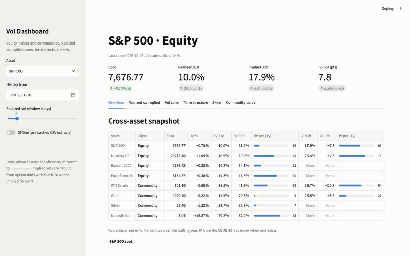
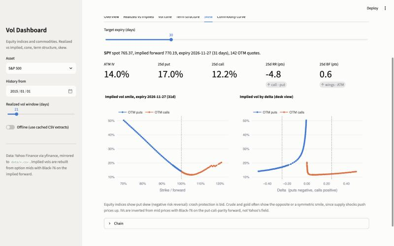

# Volatility Dashboard: equity indices and commodities

Interactive Streamlit dashboard that compares **realized and implied volatility** across
equity indices (S&P 500, Nasdaq 100, Russell 2000, Euro Stoxx 50) and commodities
(WTI crude, gold, silver, natural gas), built on free data so anyone can rerun it.





## What it shows

| Tab | Content | Why a desk cares |
|---|---|---|
| **Overview** | Cross-asset table: spot, realized vol 21d / 63d, CBOE 30d implied, IV - RV, 1y percentiles | Where is vol rich or cheap right now, in one screen |
| **Realized vs implied** | Four realized estimators (close-to-close, Parkinson, Garman-Klass, Yang-Zhang) against the CBOE index, plus the **volatility risk premium** (implied today vs realized over the next 21 days) | The VRP is the reason systematic vol selling exists, and its drawdowns are the reason it blows up |
| **Vol cone** | Distribution of realized vol by horizon (10d to 252d) over five years, current realized and implied overlaid | Is current vol extreme for its horizon, and does implied expect mean reversion |
| **Term structure** | VIX9D / VIX / VIX3M / VIX6M / VIX1Y curve, VIX/VIX3M ratio history, VVIX and SKEW | Inversion of the curve is the cleanest stress signal in equities |
| **Skew** | Live smile from the option chain of a liquid ETF proxy (SPY, QQQ, IWM, FEZ, USO, GLD, SLV, UNG): ATM, 25-delta risk reversal and butterfly, smile by moneyness and by delta | Equities pay for puts, commodities often pay for calls. The sign of the risk reversal tells you which tail the market fears |
| **Commodity curve** | Futures curve from individual contracts, contango / backwardation, annualized roll yield | In crude, curve shape and OVX move together: backwardation is scarcity and high vol |

## Implied vol is rebuilt, not read

Yahoo's `impliedVolatility` field is computed against spot without a forward, so a put and a
call at the same strike can disagree by five vol points. `options.py` does what a desk does:

1. Mid from bid/ask (falls back to last trade when the market is closed, and says so).
2. Implied forward from put-call parity on near-the-money pairs: `F = K + (C - P) / DF`.
3. Each OTM option's IV by inverting **Black-76** on that forward (Brent root-finding).
4. Forward delta, then the quotes traders use: ATM, 25d risk reversal, 25d butterfly.

Result: a smooth smile across the put/call boundary and a risk reversal with the right sign.

## Realized vol estimators

All in `metrics.py`, annualized with 252 days:

- **Close-to-close**: standard deviation of log returns.
- **Parkinson**: high-low range, about five times more efficient, blind to overnight gaps.
- **Garman-Klass**: range plus open and close, assumes no drift.
- **Yang-Zhang**: overnight + open-to-close + Rogers-Satchell, robust to gaps and drift.

## Data

Everything comes from Yahoo Finance through `yfinance` and is mirrored to `data/*.csv`
(`Date, Open, High, Low, Close`), so the dashboard runs offline and the CSVs can be
replaced by Bloomberg exports with the same layout (`SPX Index`, `VIX Index`, `CL1 Comdty`,
`OVX Index`, ...). Tickers and the equivalence are in `universe.py`.

Known limits of free data: no RVX or VSTOXX history on Yahoo, VIX1Y and VXSLV only have a
latest print, and option quotes are delayed. Futures curves use individual contract
tickers (`CLZ26.NYM`) which Yahoo lists about twelve months out.

## Run it

```bash
python3 -m venv .venv && .venv/bin/pip install -r requirements.txt
.venv/bin/streamlit run app.py
```

## Layout

```
app.py                      Streamlit UI
src/vol_dashboard/
  universe.py               assets, vol indices, option proxies, futures roots
  data.py                   yfinance loaders with CSV mirror, option chain, futures curve
  metrics.py                realized vol estimators, vol cone, VRP, term structure
  options.py                Black-76, implied forward, IV inversion, skew quotes
  charts.py                 Plotly figures
data/                       CSV extracts (auto-generated)
```

## Possible extensions

- Dispersion: implied correlation of the S&P 500 from constituent implied vols.
- Term structure of skew across several expiries, and skew history by storing daily snapshots.
- Vol-targeted basket builder using the realized vol estimators here.
